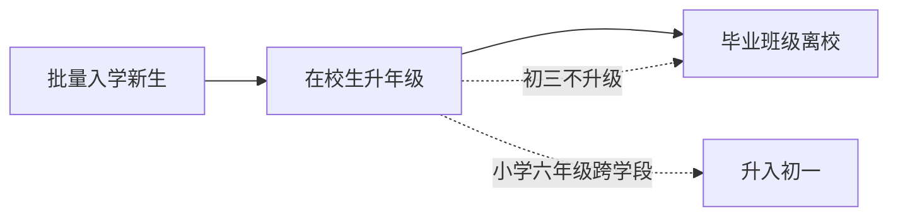

# 学籍流转批量操作

学年流转的三个核心批量操作：**批量入学新生**、**在校学生升年级**、**毕业班级离校**。

## 总览



## 一、批量入学新生（每年 9 月一年级）

### 流程

1. 管理员导入新生名单（Excel：姓名、性别、生日、家长电话等）
2. 系统为每个新生**在一个事务内**完成：
   - 生成学号（如 `20260001`，入学年份 + 顺序号）
   - 创建 `sys_user`（`login_no` = 学号，初始密码，`status` = 0 初始）
   - 创建 `student` 记录，分配到班级（如"一年级 1 班"）

### SQL 示例

```sql
BEGIN;
-- 插入用户（login_no = 学号，初始密码 BCrypt 加密，status=0 初始）
INSERT INTO sys_user (username, login_no, password, real_name, status)
VALUES ('20260001', '20260001', '<BCrypt(初始密码)>', '张三', 0);
-- 创建学生并分班
INSERT INTO student (user_id, student_no, class_id, enroll_year)
VALUES (currval('sys_user_id_seq'), '20260001', 1, 2026);
COMMIT;
```

### 关键点

- 全部在**一个事务**中执行，部分失败整体回滚，失败清单回显给管理员
- 学号规则：入学年份 + 顺序号，保证 `login_no` 全局唯一
- 初始密码统一设置，首次登录强制改密（通过 `pwd_update_time` 是否为空判断）

## 二、在校学生升年级（每年 9 月）

### 策略：班级整体升级

班级连人带班主任升到下一个年级，学生 `class_id` **无需改动**。

### SQL 示例

```sql
-- 1. 除毕业年级外，所有班级升到下一个年级（sort_order+1，天然跨越学段：六年级6→初一7）
UPDATE class c
SET grade_id = g2.id
FROM grade g, grade g2
WHERE c.grade_id = g.id
  AND g2.sort_order = g.sort_order + 1;

-- 2. 同步更新班级名称（如 "一年级1班" → "二年级1班"）
UPDATE class c
SET name = g.name || REPLACE(c.name, g.name, '')
FROM grade g
WHERE c.grade_id = g.id
  AND c.name LIKE g.name || '%';
```

### 关键点

- 跨学段自动处理：`sort_order` 连续（6 六年级 → 7 初一），无需特判
- 毕业年级（`sort_order` = 9）**不参与升级**，进入离校流程
- 学生跟着班级走，数据无需逐条迁移

## 三、毕业班级离校（初三毕业后）

### 流程

1. 对初三（`sort_order` = 9）班级执行离校
2. 学生状态变更 + 班级归档标记 + 记录毕业时间

### SQL 示例

```sql
-- 1. 毕业学生账号状态改为 8=毕业
UPDATE sys_user u
SET status = 8
FROM student s, class c, grade g
WHERE s.user_id = u.id
  AND s.class_id = c.id
  AND c.grade_id = g.id
  AND g.sort_order = 9;

-- 2. 班级标记毕业归档
UPDATE class
SET is_graduated = TRUE, graduate_time = now()
WHERE grade_id IN (SELECT id FROM grade WHERE sort_order = 9);

-- 3. 学生记录毕业时间
UPDATE student s
SET graduate_time = now()
FROM class c, grade g
WHERE s.class_id = c.id
  AND c.grade_id = g.id
  AND g.sort_order = 9;
```

## 相关表字段

| 表 | 字段 | 说明 |
|----|------|------|
| `class` | `is_graduated` | 是否已毕业离校（BOOLEAN） |
| `class` | `graduate_time` | 毕业归档时间 |
| `student` | `enroll_year` | 入学年份（按届管理、学号校验） |
| `student` | `graduate_time` | 毕业时间留档 |
| `sys_user` | `status = 8` | 毕业状态（区别于 4=转出） |

## 实现建议

- 三个操作做成独立服务（`AdmissionService` / `GradeUpgradeService` / `GraduationService`），事务包裹
- **预览 + 确认**两阶段：先展示将影响的学生/班级数量与名单，管理员确认后提交
- 记录操作日志：操作人、操作类型、影响人数、是否回滚、执行时间
