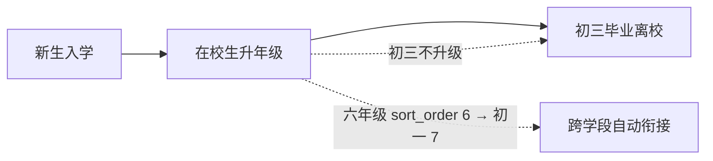
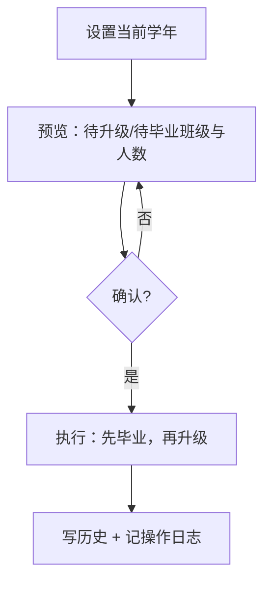

# 学籍管理：年级、学年与升级毕业

九年一贯制：小学 6 个年级 + 初中 3 个年级。本文档描述年级模型、学年、学生档案，以及每学年末的「升年级 / 毕业」批量操作。

## 总览



## 一、年级模型

| 表 | 字段 | 说明 |
|----|------|------|
| `grade` | `name` | 年级名称：一年级~六年级、初一~初三 |
| `grade` | `stage` | 学段：`PRIMARY` 小学 / `JUNIOR` 初中 |
| `grade` | `sort_order` | 排序：一年级=1 … 六年级=6、初一=7 … 初三=9 |
| `grade` | `enabled` | 1 启用 / 0 停用 |

年级种子数据（`schema.sql` 初始化）：

| 学段 | 年级 | sort_order |
|------|------|-----------|
| 小学 PRIMARY | 一 ~ 六年级 | 1 ~ 6 |
| 初中 JUNIOR | 初一、初二、初三 | 7 ~ 9 |

**设计要点**：

- 年级用**数据表**而不是枚举：以后增加学前班、高中只需插入数据，不改代码；
- `sort_order` 连续，**升级时 `+1` 即可自然跨越学段**（六年级 6 → 初一 7），无需特判；
- 学生表**不冗余年级字段**，年级通过 `student.class_id → class.grade_id` 关联，避免两处维护不一致。

## 二、学年

| 表 | 字段 | 说明 |
|----|------|------|
| `school_year` | `name` | 如 `2026-2027` |
| `school_year` | `start_date` / `end_date` | 学年起止日期 |
| `school_year` | `is_current` | 当前学年（全表最多一条为 true） |

- 升级/毕业**必须基于当前学年**执行，每学年只能执行一次；
- 后续成绩、考试的学期口径统一引用学年，避免各处手写字符串。

## 三、学生档案

| 表 | 字段 | 说明 |
|----|------|------|
| `student` | `user_id` | 对应登录账号（一对一） |
| `student` | `student_no` | 学号，全局唯一 |
| `student` | `class_id` | 所在班级（年级由班级推导） |
| `student` | `enroll_year` | 入学年份（届别管理、学号生成，**不用于推算年级**） |
| `student` | `graduate_time` | 毕业时间 |

### 新增学生

一次操作同时完成：

1. 生成学号：`入学年份 + 4 位顺序号`（如 `20260001`），也可手工填写；
2. 创建 `sys_user`：账号 = 登录号 = 学号，初始密码 `123456`，状态 `0`（初始）；
3. 绑定 `STUDENT` 角色；
4. 写入 `student` 记录并分班。

> 首次登录会被强制设置新密码；管理员也可随时按登录名重置为一次性随机密码。

### 调班

手工调整班级会写入 `student_grade_history`（`change_type = ADJUST`），记录原班级、新班级、操作人与学年。

## 四、升年级

### 策略：班级整体升级

班级连人一起升到下一个年级，**学生 `class_id` 不变**。

### 执行顺序（关键）

按年级**从高到低**处理（初二 → 初三、初一 → 初二、六年级 → 初一……）：

- 高年级先升走，目标班级的名称先腾出来；
- 再升级低年级时不会与上一届班级重名；
- 跨学段（六年级 → 初一）依赖 `sort_order` 连续，无需特判。

### 班级改名

名称中若包含原年级名，替换为新年级名：

```
一年级1班 → 二年级1班
六年级1班 → 初一1班
```

### 冲突保护

升级后目标班级名已存在时，整批回滚并报错：

> 升级后班级名称冲突：初二1班，请先处理该年级下的历史班级

### 历史记录

每个学生写入一条 `student_grade_history`：

- `change_type = PROMOTE`
- `from_class_id = to_class_id = 原班级`（班级不变，年级变化）
- `school_year_id` = 当前学年
- `remark` = 升入X年级

### 防重复执行

同一学年再次执行时，检测到该学年已有 `PROMOTE` 记录则跳过升级部分（并与毕业部分合并判断）。

## 五、毕业离校

对**最后一学段**（`sort_order = 9`，初三）的班级执行：

1. 班级：`is_graduated = true`、写入 `graduate_time`；
2. 班级改名追加届别：`初三1班 → 初三1班（2027届）`，让新一届可以复用原名称而不冲突；
3. 学生：`graduate_time` 写入，账号状态置为 **8（毕业）**；
4. 历史：写入 `student_grade_history`，`change_type = GRADUATE`、`to_class_id` 为空；
5. 同一学年同样只执行一次。

> 毕业班级归档后，历史成绩、消息等数据仍按 `class_id` 可查，不删除数据。

## 六、执行流程（预览 + 确认）



- `GET /api/admin/academic/promotion/preview`：返回班级对照表、学生人数、本学年是否已执行；
- `POST /api/admin/academic/promotion/execute`：一个事务内先毕业再升级，任一步失败整体回滚；
- 执行结果写入操作日志（模块 `ACADEMIC`，动作 `PROMOTE_GRADUATE`）。

## 七、接口

| 方法 | 路径 | 说明 |
|------|------|------|
| GET | `/api/admin/academic/grades` | 年级列表 |
| GET | `/api/admin/academic/classes` | 班级列表（含人数） |
| POST/PUT | `/api/admin/academic/classes` | 新增 / 编辑班级 |
| GET | `/api/admin/academic/students` | 学生分页（按姓名/学号/班级筛选） |
| POST/PUT | `/api/admin/academic/students` | 新增 / 编辑学生（新增自动建账号） |
| GET | `/api/admin/academic/school-years` | 学年列表 |
| POST | `/api/admin/academic/school-years` | 新增学年（可设为当前） |
| POST | `/api/admin/academic/school-years/{id}/current` | 设为当前学年 |
| GET | `/api/admin/academic/promotion/preview` | 升级/毕业预览 |
| POST | `/api/admin/academic/promotion/execute` | 执行升级/毕业 |

## 八、相关表与状态

| 表 / 字段 | 说明 |
|----------|------|
| `class.is_graduated` / `graduate_time` | 班级毕业归档 |
| `student.graduate_time` | 学生毕业时间 |
| `sys_user.status = 8` | 毕业状态（区别于 4 = 转出） |
| `student_grade_history` | 年级/班级变更历史（PROMOTE / GRADUATE / ADJUST / TRANSFER_IN / REPEAT / SKIP） |
| `school_year` | 学年口径 |

## 九、实现位置

| 层 | 文件 |
|----|------|
| 实体 | `backend/.../entity/Grade.java`、`SchoolClass.java`、`Student.java`、`SchoolYear.java`、`StudentGradeHistory.java` |
| 服务 | `backend/.../service/impl/AcademicServiceImpl.java` |
| 接口 | `backend/.../controller/admin/AcademicController.java` |
| 页面 | `frontend/src/views/admin/AcademicManagement.vue`（学生/班级/年级/学年/升级毕业 五个标签页） |

## 十、待实现

- **批量入学**：Excel 导入新生名单，事务内批量建账号与学籍，失败清单回显；
- 学生详情页（变更历史时间线）；
- 按年级/学段的学生与班级统计报表。
