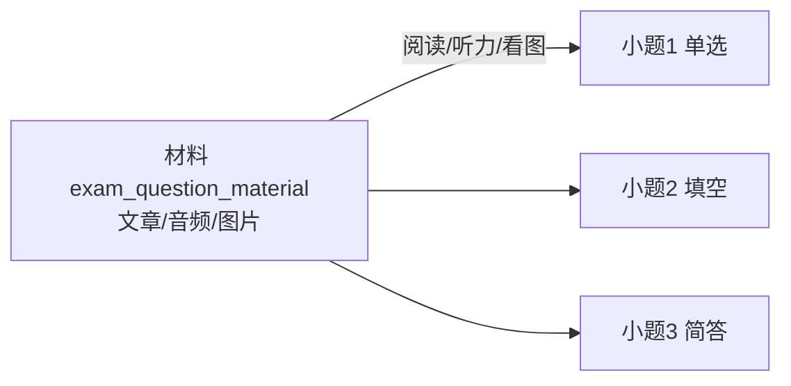
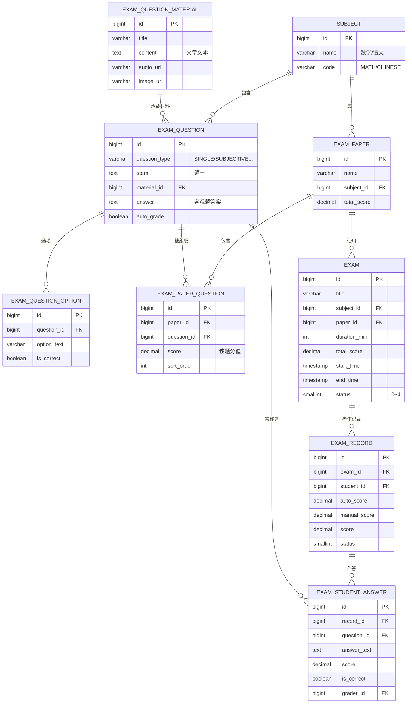
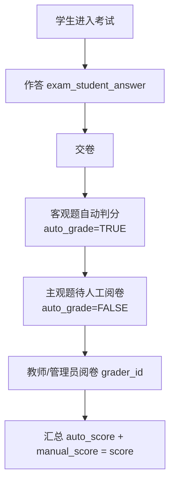

# 在线考试模块

支持数学、语文等科目的在线考试，覆盖**客观题**（自动判分）与**主观题**（人工阅卷），以及**阅读题 / 听力题 / 看图题**等材料型题目。

## 题型建模（核心设计）

题目分为两类：**独立小题** 与 **材料题**。

| 分类 | 作答类型（question_type） | 判分方式 | 材料 |
|------|--------------------------|---------|------|
| 客观题 | `SINGLE_CHOICE` 单选 | 自动 | 无 |
| 客观题 | `MULTIPLE_CHOICE` 多选 | 自动 | 无 |
| 客观题 | `JUDGE` 判断 | 自动 | 无 |
| 客观题 | `FILL_BLANK` 填空 | 自动/人工 | 无 |
| 主观题 | `SUBJECTIVE` 简答/解答/作文 | 人工 | 无 |
| 材料题 | 阅读题 = 文章 + 若干小题 | 按小题 | 文本材料 |
| 材料题 | 听力题 = 音频 + 若干小题 | 按小题 | 音频材料 |
| 材料题 | 看图题 = 图片 + 若干小题 | 按小题 | 图片材料 |

**材料题的关键设计**：阅读/听力/看图题由「一段共享材料 + 一组小题」组成，建模为两张表：

- `exam_question_material`：存材料本身（文章文本 / 音频 / 图片）
- `exam_question`：存小题，通过 `material_id` 关联到材料；每个小题仍用 `question_type` 决定作答方式（阅读题下可以是选择题，也可以是简答题）

## ER 图

## 表清单

| 表 | 说明 |
|----|------|
| `subject` | 科目（数学/语文/英语…） |
| `exam_question_material` | 题目材料（阅读文章/听力音频/看图图片） |
| `exam_question` | 题目（作答类型 + 可选材料） |
| `exam_question_option` | 选择题选项（含正确答案标记） |
| `exam_paper` | 试卷 |
| `exam_paper_question` | 试卷-题目关联（分值、顺序） |
| `exam` | 考试活动（绑定试卷、时间、时长） |
| `exam_record` | 学生考试记录（进入/交卷/得分/状态） |
| `exam_student_answer` | 学生每道题的作答与得分 |

## 判分流程

- **客观题**（单选/多选/判断/客观填空）：`auto_grade = TRUE`，交卷后自动判分
  - 选择题答案存于 `exam_question_option.is_correct`
  - 填空/判断答案存于 `exam_question.answer`
- **主观题**（简答/解答/作文）：`auto_grade = FALSE`，由教师阅卷，记录 `grader_id` 和 `grade_time`
- 材料题（阅读/听力/看图）按内部小题的 `auto_grade` 分别判分

## 考试状态流转

`exam.status`：`0草稿 → 1已发布 → 2进行中 → 3已结束 → 4已归档`

`exam_record.status`：`0未开始 → 1作答中 → 2已提交 → 3已阅卷`

## 实现建议

- **组卷**：试卷由 `exam_paper_question` 按顺序组织，支持从题库选题、设置每题分值
- **防作弊**（可选）：题目乱序（`exam_paper_question.sort_order` 按学生随机）、考试中禁止切屏（前端检测）
- **听力题**：`audio_url` 存音频文件地址（对象存储），前端播放
- **成绩汇总**：`exam_record.score` 实时累计，阅卷完成后总分生效
- 后续可扩展：`exam_class`（考试参与班级）、`exam_schedule`（考试安排）、成绩单导出
