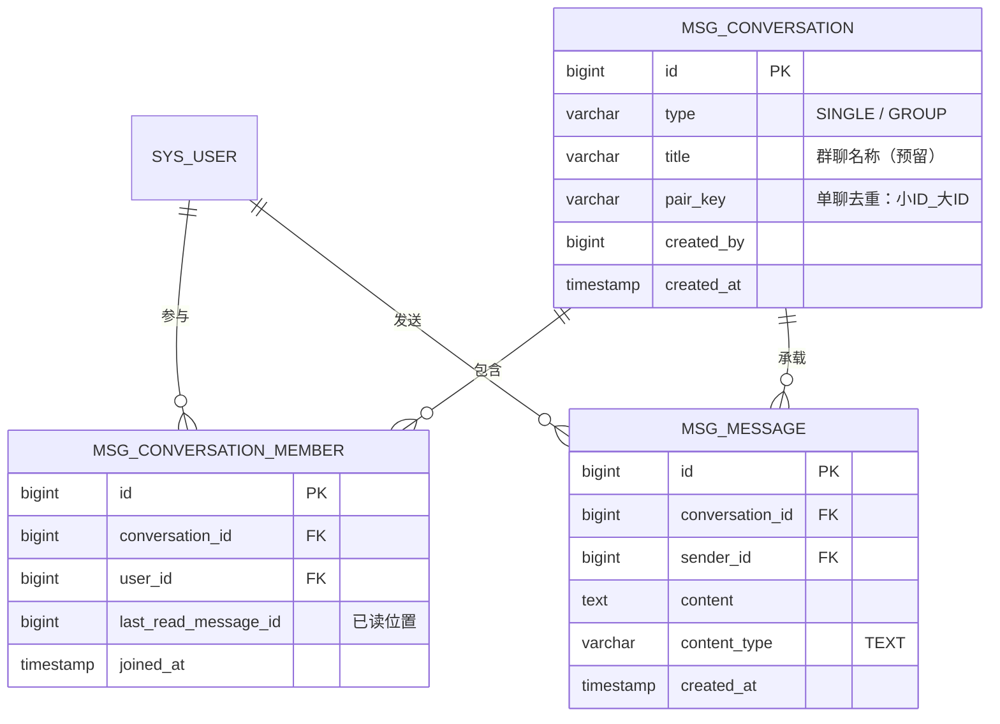

# 消息模块（1:1 单聊）

用户之间一对一发送消息，支持未读提醒、历史消息与轮询新消息。

## 数据模型（3 张表）



### 关键设计

- **`pair_key`**：单聊唯一键 `小用户ID_大用户ID`，重复发起会话时直接复用，不产生重复会话；
- **`last_read_message_id`**：每个成员记录读到的最大消息 ID，未读数通过一次查询算出，无需冗余计数字段；
- **按 `id` 排序**：消息顺序以自增 ID 为准，避免同一秒内按时间排序不稳定；
- **`type = GROUP`**：为后续群聊预留，当前只使用 `SINGLE`。

## 未读数计算

```sql
-- 单个会话未读
SELECT count(*) FROM msg_message m
JOIN msg_conversation_member cm
  ON cm.conversation_id = m.conversation_id AND cm.user_id = :me
WHERE m.id > COALESCE(cm.last_read_message_id, 0)
  AND m.sender_id <> :me;

-- 全局未读（顶部角标）
SELECT count(*) FROM msg_message m
JOIN msg_conversation_member cm
  ON cm.conversation_id = m.conversation_id AND cm.user_id = :me
WHERE (cm.last_read_message_id IS NULL OR m.id > cm.last_read_message_id)
  AND m.sender_id <> :me;
```

## 接口

| 方法 | 路径 | 说明 |
|------|------|------|
| GET | `/api/messages/conversations` | 我的会话列表（对方、最后一条、未读数） |
| POST | `/api/messages/conversations` | `{peerUserId}` 开始单聊，已存在则复用 |
| GET | `/api/messages/conversations/{id}/messages` | 历史/增量消息：`beforeId` 向上翻页、`afterId` 轮询增量 |
| POST | `/api/messages/conversations/{id}/messages` | `{content}` 发送消息 |
| POST | `/api/messages/conversations/{id}/read` | 标记会话已读 |
| GET | `/api/messages/unread-count` | 未读总数（角标） |
| GET | `/api/messages/contacts?keyword=` | 可发消息的用户（排除自己） |

## 轮询策略

| 场景 | 频率 | 说明 |
|------|------|------|
| 会话列表 | 30 秒 | 页面打开时刷新 |
| 打开的会话 | 5 秒 | 按 `afterId` 拉增量，避免整页重载 |
| 未读角标 | 30 秒 | 全局轮询，页面隐藏时暂停 |

> 轮询请求**不触发**「5 分钟无操作自动退出」的活跃计时，只有真实的鼠标/键盘操作才算活跃。

## 权限与安全

- 所有登录用户可互发消息（第一版不做角色限制）；
- 会话相关接口统一校验「当前用户是该会话成员」，防止越权读取；
- 禁止给自己发消息；内容 `trim` 后 1~2000 字；
- 前端纯文本渲染，不使用 `v-html`，防 XSS；
- **消息内容不写入操作日志**：`msg_message` 本身即审计记录，避免隐私扩散与日志表膨胀。

## 前端结构

| 文件 | 作用 |
|------|------|
| `frontend/src/views/message/MessageCenter.vue` | 消息中心（会话列表 + 聊天窗） |
| `frontend/src/components/message/NewConversationDialog.vue` | 搜索用户、发起会话 |
| `frontend/src/components/common/MessageBell.vue` | 顶部消息图标 + 未读角标 |
| `frontend/src/store/message.js` | 未读总数状态 |
| `frontend/src/api/message.js` | 接口封装 |

## 后续扩展

- 群聊 / 系统公告（`type = GROUP` 已预留）
- 图片、文件消息（`content_type` 已预留）
- WebSocket 实时推送（替换轮询，数据模型不变）
- 消息撤回、搜索、举报与敏感词拦截
