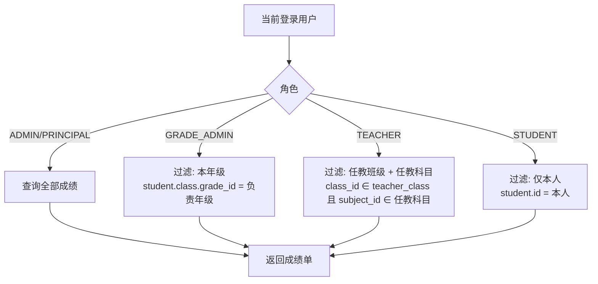

# 成绩单模块

成绩单面向不同角色展示不同范围的数据，**数据权限（`data_scope`）是核心**，复用权限模型设计。

## 数据权限矩阵（核心）

| 角色 | 可见范围 | 数据过滤条件 |
|------|---------|-------------|
| 系统管理员 `ADMIN` | 全部成绩 | 无过滤 |
| 校长 `PRINCIPAL` | 全部学生成绩 | 无过滤 |
| 年级管理员 `GRADE_ADMIN` | 本年级成绩 | `student.class.grade_id` = 负责年级 |
| 教师 `TEACHER` | 本人任教班级 + 任教科目的成绩 | `student.class_id` ∈ 任教班级 且 `subject_id` ∈ 任教科目 |
| 学生 `STUDENT` | 仅自己的成绩 | `student.id` = 本人 |



> 教师同时是年级管理员时（多角色），权限取并集：本年级 + 本人任教班级。

## 成绩来源

成绩记录在 `score` 表，两个来源：

1. **考试自动生成**：考试阅卷完成后，从 `exam_record` 汇总写入 `score`（`exam_id` 非空）
2. **手工录入**：平时成绩、补考成绩等，教师/管理员录入（`exam_id` 为空）

## 表结构

### `score` 成绩记录表

| 字段 | 说明 |
|------|------|
| `student_id` | 学生 |
| `subject_id` | 科目 |
| `exam_id` | 来源考试（可空=手工录入） |
| `exam_type` | MIDTERM 期中 / FINAL 期末 / NORMAL 平时 |
| `term` | 学期（如 2025-2026-1） |
| `score` | 成绩 |
| `recorded_by` | 录入人 |

### `exam` 补充字段

| 字段 | 说明 |
|------|------|
| `term` | 学期，用于按学期组织成绩 |
| `exam_type` | 考试类型（期中/期末/平时） |

## 排名计算（查询时动态计算，不存储）

```sql
-- 班级排名
SELECT st.id AS student_id,
       ROW_NUMBER() OVER (PARTITION BY s.subject_id, st.class_id
                          ORDER BY s.score DESC) AS rank_in_class
FROM score s
JOIN student st ON st.id = s.student_id
WHERE s.term = '2025-2026-1';

-- 年级排名（按学生所在年级分组）
SELECT st.id AS student_id,
       ROW_NUMBER() OVER (PARTITION BY s.subject_id, g.id
                          ORDER BY s.score DESC) AS rank_in_grade
FROM score s
JOIN student st ON st.id = s.student_id
JOIN class c ON c.id = st.class_id
JOIN grade g ON g.id = c.grade_id
WHERE s.term = '2025-2026-1';
```

## 查询示例（带数据权限）

学生某学期成绩单：

```sql
SELECT su.real_name, sub.name AS subject, s.score, s.exam_type, s.term
FROM score s
JOIN student st ON st.id = s.student_id
JOIN sys_user su ON su.id = st.user_id
JOIN subject sub ON sub.id = s.subject_id
WHERE s.term = '2025-2026-1'
  -- 数据权限条件（由 @DataScope 自动注入，以下为示例）：
  AND st.id = :currentStudentId   -- 学生
  -- 年级管理员: AND st.class_id IN (SELECT id FROM class WHERE grade_id = :gradeId)
  -- 教师:       AND st.class_id IN (SELECT class_id FROM teacher_class WHERE teacher_id = :teacherId)
  --             AND s.subject_id IN (SELECT DISTINCT subject FROM teacher_class WHERE teacher_id = :teacherId)
ORDER BY sub.sort_order;
```

## 实现建议

- **`@DataScope` AOP 注解**：成绩查询统一走一个 `ScoreService`，方法上标注数据范围，AOP 根据当前用户角色自动拼接过滤条件
- **教师任教科目**：从 `teacher_class.subject` 取（教师可能教多个班级多门课）
- **成绩汇总视图**：可建数据库视图 `v_score_report` 提前 JOIN 好学生/班级/年级/科目，简化查询
- **排名一致性**：排名用窗口函数动态计算，避免并发写导致排名错乱
- 后续可扩展：成绩导出（Excel）、成绩分析（平均分/及格率/优秀率）、家长查看权限
